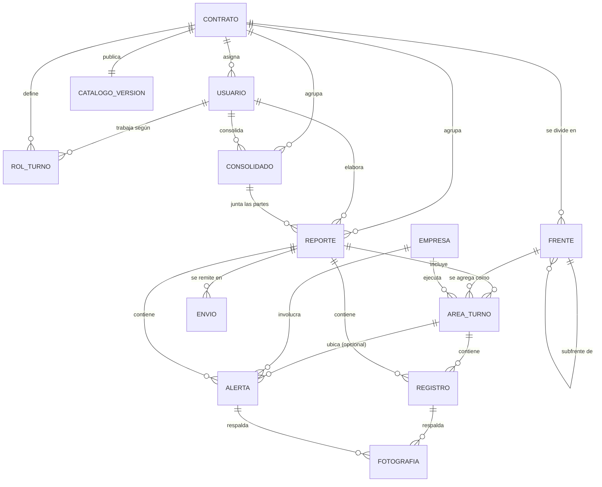

# Estructura de datos preliminar

**Proyecto:** Bitácora - ITO
**Fecha:** 30 de septiembre de 2026
**Base:** Reporte Diario de Inspección de Construcción, código de proyecto 4600026893-8211-FRMCS-00001, revisión 1. Ejemplares del 24 y 27 de septiembre de 2026, turno día.
**Estado:** preliminar. Se ajustará a medida que avance el desarrollo.
**Datos personales:** la finalidad, quién ve y cuánto se conserva cada dato personal están en la [ficha de tratamiento de datos](etica.md#2-ficha-de-tratamiento-de-datos-personales) (semana 7).
**Actualización:** 20 de octubre de 2026 (versión 2). Recoge las observaciones del profesor guía: las áreas se eligen de una lista y el PDF se previsualiza. Suma además el historial con rol de turnos (ver §9).
**Actualización:** 4 de noviembre de 2026 (semana 8). Varios inspectores por turno, firma de cada parte y un solo reporte consolidado que envía el jefe de turno (ver §10). Donde una regla antigua cambió, se indica junto a ella.

---

## 1. Criterio de diseño

El modelo se construyó **desde el reporte hacia el terreno**: se tomó el formato que hoy recibe el mandante y se definió dónde se captura cada dato durante la jornada. La regla es que **todo campo que aparece en el reporte debe tener origen en la captura de terreno o en la configuración del contrato**; si un dato no tiene origen, o falta capturarlo, o sobra en el reporte.

Una segunda regla, acordada con el equipo: **el modelo guarda lo que el reporte informa, y nada más**. El reporte es la constancia de un turno, no un sistema de seguimiento; por eso no existen estados de avance, cierres ni plazos.

## 2. Entidades

| Entidad | Qué representa |
|---|---|
| `usuario` | Inspector de terreno, jefe de turno (`jefatura`) o administrador |
| `contrato` | Servicio de inspección con su mandante, su formato de reporte y sus destinatarios |
| `empresa` | Contratista o laboratorio que ejecuta trabajos en la obra (TECNASIC, GEOINYECTA, IDIEM, OOCC) |
| `frente` | **Área** del contrato (en la aplicación se llama «área»), jerárquica (área → subárea). Es un catálogo precargado con el contrato: el inspector la **elige de una lista** y no la escribe (versión 2) |
| `area_turno` | Área agregada al reporte de un turno junto con la empresa que la ejecuta; fija la numeración del reporte (1.0, 2.0…) *(versión 2)* |
| `rol_turno` | Rol de turnos del inspector (7x7) y el primer día de su turno; distingue los días de descanso de los informes no entregados *(versión 2)* |
| `reporte` | Reporte diario de un contrato, una fecha y un turno |
| `registro` | Actividad observada en un subfrente, o su declaración de «sin actividad» |
| `alerta` | Hecho que se publica en la tabla de alertas del reporte |
| `fotografia` | Imagen asociada a un registro o a una alerta |
| `envio` | Remisión del reporte al mandante |
| `consolidado` | Reporte único del turno que arma el jefe de turno con las partes firmadas *(semana 8)* |
| `catalogo_version` | Versión del catálogo publicado desde el Excel del administrador *(semana 8)* |

## 3. Relaciones

En palabras:

- Un **contrato** trae su catálogo de **áreas** (tabla `frente`, que puede anidar subáreas) y de **empresas**, y tiene sus inspectores asignados. Desde la versión 2, el catálogo lo carga la jefatura con el contrato. El inspector solo **elige** de la lista qué áreas trabaja en su turno y con qué empresa (`area_turno`).
- Cada inspector tiene un **rol de turnos** (`rol_turno`, 7x7) con el primer día de su turno. Con él, el historial distingue un día de descanso de un día de trabajo sin informe.
- Un **reporte** es la **parte** de un inspector: un contrato, una fecha, un turno y un inspector. El inspector la firma al cerrarla *(semana 8)*.
- Un **consolidado** junta las partes firmadas del día en el único reporte que recibe el mandante. Lo arma y lo envía el jefe de turno *(semana 8)*.
- Un **registro** pertenece a un reporte y cuelga de un **área del turno** (`area_turno`), que ya trae el área y la empresa que ejecuta el trabajo.
- Una **alerta** pertenece a un reporte y se publica en una de las cuatro columnas del formato: Construcción, Laboratorio, Topografía o Interferencia.
- Las **fotografías** cuelgan del registro o de la alerta, lo que permite agruparlas por frente en el anexo.

## 4. Diccionario de campos

### 4.1 `usuario`

| Campo | Tipo | Obligatorio | Ejemplo |
|---|---|---|---|
| `id` | uuid | Sí | `9c1e…` |
| `nombre` | texto | Sí | `Jorge Orellana S.` |
| `correo` | texto | No *(opcional desde la semana 8)* | `jorellana@empresa.cl` |
| `rol` | enum (`inspector`, `jefatura`, `admin`) | Sí | `inspector` |
| `contrato_id` | uuid (FK) | No *(semana 8)* | `4f77…` |
| `activo` | booleano | Sí | `true` |

### 4.2 `contrato`

| Campo | Tipo | Obligatorio | Ejemplo |
|---|---|---|---|
| `id` | uuid | Sí | `4f77…` |
| `nombre` | texto | Sí | `Servicio de ITO y Apoyo a la Construcción de Carén` |
| `numero` | texto | No | `4600026893` |
| `mandante` | texto | Sí | `<mandante>` |
| `codigo_proyecto` | texto | Sí | `4600026893-8211-FRMCS-00001` |
| `codigo_interno` | texto | No | `JEJ-664-CT-INF-002` |
| `revision_formato` | texto | Sí | `1` |
| `fecha_formato` | texto | No | `02-07-2024` |
| `prefijo_correlativo` | texto | Sí | `4600026893-8211-INDCS-` |
| `ultimo_correlativo` | entero | Sí | `1972` |
| `destinatarios` | lista de texto | Sí | `["inspeccion@mandante.cl"]` |
| `hora_cierre_turno_dia` | hora | No | `19:00` |

> `prefijo_correlativo` y `ultimo_correlativo` son lo que permite que el sistema asigne el número del reporte sin intervención manual. La serie es una sola y corre de forma continua. *(Semana 8: el número que sale al mandante lo toma el reporte consolidado del jefe de turno; ver §10, regla 4.)*

### 4.3 `empresa`

| Campo | Tipo | Obligatorio | Ejemplo |
|---|---|---|---|
| `id` | uuid | Sí | `c330…` |
| `contrato_id` | uuid (FK) | Sí | `4f77…` |
| `nombre` | texto | Sí | `TECNASIC` |
| `tipo` | enum (`contratista`, `laboratorio`, `topografia`, `obras_civiles`, `otro`) | Sí | `contratista` |

### 4.4 `frente`

| Campo | Tipo | Obligatorio | Ejemplo |
|---|---|---|---|
| `id` | uuid | Sí | `a012…` |
| `contrato_id` | uuid (FK) | Sí | `4f77…` |
| `frente_padre_id` | uuid (FK) | No | `a011…` (vacío si es frente de primer nivel) |
| `numero` | texto | Sí | `1.2` |
| `nombre` | texto | Sí | `Excavación y rellenos de 1A zanja cortafuga` |
| `empresa_id` | uuid (FK) | No | `c330…` |
| `orden` | entero | Sí | `12` |
| `cargado_por` | uuid (FK) | Sí | `9c1e…` (jefatura) |
| `creado_en` | timestamp | Sí | `2026-09-12T09:40:00-03:00` |
| `ultimo_uso` | fecha | No | `2026-09-27` |
| `vigente` | booleano | Sí | `true` |

> `frente_padre_id` reproduce la jerarquía del reporte: 1.0 Muro Sotelo contiene 1.1, 1.2 y 1.3. `orden` fija la secuencia en que se imprimen las secciones.
>
> **Versión 2:** el catálogo de áreas **viene precargado con el contrato** y lo mantiene la jefatura. El inspector no escribe áreas: las elige de una lista desplegable. Las 14 áreas de ejemplo salen de la lista del contrato: Vertedero Morning Glory, Acceso a obra de captación, Fortificación Tramo B, Peralte Muro Sotelo, Instrumentación geotécnica Muro Sotelo, Torre de Captación, Túnel PAMo, Sistema de Manejo de Aguas, Mentidero, La Bodega, Tramo A, Tramo B, Traucalén y Sondajes.
>
> `ultimo_uso` permite proponer primero las áreas del reporte anterior. `vigente` deja de ofrecer las que ya terminaron, sin borrar los reportes donde aparecen. En la versión 2, `numero` ya no se escribe: la numeración del reporte la da `area_turno.orden`.

### 4.5 `reporte`

| Campo | Tipo | Obligatorio | Ejemplo |
|---|---|---|---|
| `id` | uuid | Sí | `7bd3…` |
| `contrato_id` | uuid (FK) | Sí | `4f77…` |
| `fecha` | fecha | Sí | `2026-09-27` |
| `turno` | enum (`dia`, `noche`) | Sí | `dia` |
| `correlativo` | texto | Sí | `4600026893-8211-INDCS-01972` |
| `elaborado_por` | uuid (FK) | Sí | `9c1e…` |
| `clima_turno` | enum (`despejado`, `nublado`, `lluvia`) | Sí | `despejado` |
| `clima_proyeccion` | enum (`despejado`, `nublado`, `lluvia`) | Sí | `despejado` |
| `estado` | enum (`borrador`, `generado`, `aprobado`, `enviado`) | Sí | `aprobado` |
| `hora_generacion` | timestamp | No | `2026-09-27T17:52:00-03:00` |
| `hora_aprobacion` | timestamp | No | `2026-09-27T17:56:00-03:00` (desde la semana 8: hora de la firma del inspector) |
| `aprobado_por` | uuid (FK) | No | `9c1e…` (desde la semana 8: quién firmó la parte) |
| `entregado_en` | timestamp | No *(semana 8)* | `2026-09-27T17:57:00-03:00` (firmada y enviada al jefe de turno) |
| `url_pdf` | texto | No | `https://…/reporte_2026-09-27.pdf` |
| `resumen_turno` | texto largo | No | `Turno sin novedades críticas. Se ejecutó avance en Muro Sotelo.` |

> **Desde la semana 8**, `reporte` es la parte de **un** inspector. Varios inspectores trabajan el mismo turno y cada uno tiene su parte. El reporte que recibe el mandante es el `consolidado`, y en su «Elaborado por» aparecen todos los inspectores. Solo se usa el turno de día.

### 4.6 `registro`

| Campo | Tipo | Obligatorio | Ejemplo |
|---|---|---|---|
| `id` | uuid | Sí | `e5a9…` |
| `reporte_id` | uuid (FK) | Sí | `7bd3…` |
| `area_turno_id` | uuid (FK) | Sí | `f310…` (área del turno, con su empresa) |
| `sin_actividad` | booleano | Sí | `false` |
| `descripcion` | texto largo | Sí (si `sin_actividad` es falso) | `Se realiza extendido y compactación de material 1A, 5.ª capa 30 cm…` |
| `origen_descripcion` | enum (`dictado`, `escrito`) | Sí | `dictado` |
| `latitud` | decimal | No | `-22.451200` |
| `longitud` | decimal | No | `-68.923100` |
| `registrado_en` | timestamp | Sí | `2026-09-27T10:24:00-03:00` |
| `sincronizado_en` | timestamp | No | `2026-09-27T12:05:00-03:00` |

> Los datos técnicos (Pk, cota, capa, cantidad, liberaciones de calidad, topografía y laboratorio) van **dentro de la descripción**, tal como se redactan hoy: el inspector dicta la actividad completa y no llena campos adicionales en terreno. `registrado_en` y `sincronizado_en` separadas permiten demostrar que la observación se levantó en terreno aunque no hubiera señal.

### 4.7 `alerta`

| Campo | Tipo | Obligatorio | Ejemplo |
|---|---|---|---|
| `id` | uuid | Sí | `b7c1…` |
| `reporte_id` | uuid (FK) | Sí | `7bd3…` |
| `columna` | enum (`construccion`, `laboratorio`, `topografia`, `interferencia`) | Sí | `construccion` |
| `empresa_id` | uuid (FK) | Sí en la app | `c330…` |
| `area_turno_id` | uuid (FK) | No | `f310…` (vacío = «Sin área específica») |
| `descripcion` | texto largo | Sí | `En zanja de anclaje ZCF los rellenos de las últimas 2 capas no presentan la misma consistencia…` |
| `criticidad` | enum (`baja`, `media`, `alta`) | Sí | `media` |
| `registrado_en` | timestamp | Sí | `2026-09-27T14:10:00-03:00` |

> La observación que detecta el inspector se publica aquí, en la tabla de alertas, con la criticidad que él mismo indica en escala baja, media o alta. La criticidad es el único campo que el formato actual no contempla. La alerta pertenece al reporte del día y **no se arrastra ni se cierra**: si la situación persiste, el inspector la vuelve a reportar.

### 4.8 `fotografia`

| Campo | Tipo | Obligatorio | Ejemplo |
|---|---|---|---|
| `id` | uuid | Sí | `11c4…` |
| `registro_id` | uuid (FK) | No | `e5a9…` |
| `alerta_id` | uuid (FK) | No | `b7c1…` |
| `reporte_id` | uuid (FK) | No | `7bd3…` (atajo para buscar las fotos de un reporte) |
| `ruta` | texto | Sí | ruta de la imagen en el almacenamiento `fotos` de Supabase |
| `url` | texto | No | `https://…/f-01972-01.jpg` |
| `orden` | entero | Sí | `1` |
| `pie_foto` | texto | No | `Muro Sotelo, extendido capa 17` |
| `capturada_en` | timestamp | Sí | `2026-09-27T10:22:00-03:00` |
| `latitud` | decimal | No | `-22.451200` |
| `longitud` | decimal | No | `-68.923100` |

> Toda fotografía cuelga de un registro o de una alerta, nunca de ambos ni de ninguno. Un avance exige al menos una fotografía; una alerta solo si es de criticidad alta. El anexo fotográfico se arma siguiendo el `orden` del frente al que pertenece el registro.

### 4.9 `envio`

| Campo | Tipo | Obligatorio | Ejemplo |
|---|---|---|---|
| `id` | uuid | Sí | `d7f0…` |
| `reporte_id` | uuid (FK) | Sí | `7bd3…` |
| `enviado_por` | uuid (FK) | Sí | `9c1e…` |
| `destinatarios` | lista de texto | Sí | `["inspeccion@mandante.cl"]` |
| `estado` | enum (`en_cola`, `enviando`, `enviado`, `fallido`) | Sí | `enviado` |
| `creado_en` | timestamp | Sí | `2026-09-27T17:57:00-03:00` |
| `enviado_en` | timestamp | No | `2026-09-27T17:58:00-03:00` |
| `intentos` | entero | Sí | `1` |
| `error` | texto | No | motivo del último fallo |
| `acuse_recibido` | booleano | No | `true` |

> **Semana 8:** `envio` queda para los envíos del inspector anteriores a la consolidación. El envío del reporte consolidado se registra en `consolidado` (`estado` = `enviado` y `enviado_en`).

### 4.10 `area_turno` *(versión 2)*

| Campo | Tipo | Obligatorio | Ejemplo |
|---|---|---|---|
| `id` | uuid | Sí | `f310…` |
| `reporte_id` | uuid (FK) | Sí | `7bd3…` |
| `frente_id` | uuid (FK) | Sí | `a012…` (Peralte Muro Sotelo) |
| `empresa_id` | uuid (FK) | Sí | `c330…` (TECNASIC) |
| `orden` | entero | Sí | `2` → se imprime como sección 2.0 y la empresa como 2.1 |
| `agregada_en` | timestamp | Sí | `2026-10-14T08:05:00-03:00` |

> Se crea cuando el inspector toca «Agregar área» y elige el área y la empresa. Los registros del turno (`registro`) cuelgan del área del turno a través de `area_turno_id`. Un área no puede aparecer dos veces en el mismo reporte. Al abrir un turno nuevo, el inspector parte con las áreas de su reporte anterior.

### 4.11 `rol_turno` *(versión 2)*

| Campo | Tipo | Obligatorio | Ejemplo |
|---|---|---|---|
| `id` | uuid | Sí | `9a77…` |
| `usuario_id` | uuid (FK) | Sí | `9c1e…` |
| `contrato_id` | uuid (FK) | Sí | `4f77…` |
| `dias_trabajo` | entero | Sí | `7` |
| `dias_descanso` | entero | Sí | `7` |
| `fecha_inicio` | fecha | Sí | `2026-10-08` (primer día de turno marcado por el inspector) |
| `vigente_desde` | fecha | Sí | `2026-10-08` |

> Para cualquier fecha, el día del ciclo es `(fecha − fecha_inicio) mod (dias_trabajo + dias_descanso)`. Si es menor que `dias_trabajo`, es día de trabajo; si no, es descanso. En el calendario, un día de trabajo con `envio` en estado `enviado` sale **verde**, un día de trabajo sin envío ya pasado sale **rojo** y un día de descanso sale **gris**. Cada `fecha_inicio + k × 14` se marca como inicio de turno.

### 4.12 `consolidado` *(semana 8)*

| Campo | Tipo | Obligatorio | Ejemplo |
|---|---|---|---|
| `id` | uuid | Sí | `5c2a…` |
| `contrato_id` | uuid (FK) | Sí | `4f77…` |
| `fecha` | fecha | Sí | `2026-10-30` |
| `turno` | enum (`dia`, `noche`) | Sí | `dia` |
| `correlativo` | texto | Sí | `4600026893-8211-INDCS-01973` |
| `consolidado_por` | uuid (FK) | No | `9c1e…` (jefe de turno) |
| `partes` | lista de uuid | Sí | ids de los `reporte` incluidos |
| `elaborado_por_texto` | texto | No | `Jorge Orellana S. / Alberto Castillo` |
| `clima_turno` | enum | No | `despejado` (lo elige el jefe; por defecto, el más repetido en las partes) |
| `clima_proyeccion` | enum | No | `despejado` |
| `estado` | enum (`borrador`, `generado`, `aprobado`, `enviado`) | Sí | `enviado` |
| `ruta_pdf` | texto | No | ruta del PDF en el almacenamiento `reportes` |
| `enviado_en` | timestamp | No | `2026-10-30T18:40:00-03:00` |
| `creado_en` | timestamp | Sí | `2026-10-30T18:30:00-03:00` |

### 4.13 `catalogo_version` *(semana 8)*

| Campo | Tipo | Obligatorio | Ejemplo |
|---|---|---|---|
| `contrato_id` | uuid (FK, clave) | Sí | `4f77…` |
| `version` | entero | Sí | `3` |
| `cargado_por` | uuid (FK) | No | `9c1e…` (administrador) |
| `cargado_en` | timestamp | Sí | `2026-11-01T22:10:00-03:00` |
| `nota` | texto | No | resumen de cambios |

> El Excel del administrador tiene cuatro hojas: Contrato (con los destinatarios y la hora de cierre), Áreas, Empresas y Usuarios (nombre, correo opcional, rol y activo). El rol de turnos 7x7 no va en el Excel: la demostración trae uno por inspector y cada uno puede cambiar su primer día de turno en el Historial.

## 5. Reglas de negocio

1. *(Cambia en la semana 8: ver §10, regla 1.)* Existe **un solo reporte por contrato, fecha y turno**, y cada turno lo elabora un inspector distinto. Al registrar la primera actividad, el reporte se crea en estado `borrador` y toma el correlativo siguiente de la serie del contrato, que es única y continua para ambos turnos.
2. Un frente **sin registros al cierre del turno** obliga al inspector a confirmar «sin actividad»: el reporte no se genera con frentes en blanco.
3. *(Versión 2)* El inspector **no crea ni escribe áreas**: elige del catálogo del contrato y la empresa que la ejecuta. La jefatura puede agregar o dar de baja áreas del catálogo; el cambio rige desde el reporte en curso y no altera los reportes ya emitidos.
4. Una alerta de criticidad `alta` **exige al menos una fotografía**.
5. Un reporte solo pasa a `enviado` después de `aprobado`: **la aprobación humana es obligatoria** y queda registrada con autor y hora. *(Semana 8: la parte del inspector se aprueba con su firma; el consolidado lo aprueba el jefe de turno.)*
6. Los registros capturados sin señal conservan su `registrado_en` original al sincronizar.
7. Un reporte enviado **no se edita**: una corrección genera un nuevo `envio` sobre el mismo reporte, con trazabilidad de ambos.
8. Cada reporte es **independiente**: las alertas pertenecen al día en que se levantaron y no se heredan ni se cierran en reportes posteriores.
9. *(Versión 2)* La aprobación de la regla 5 **solo se puede dar desde la vista previa del PDF**: el reporte pasa a `generado` cuando se arma el PDF de la vista previa y a `aprobado` cuando se toca «Aprobar y enviar» después de verlo. *(Semana 8: la vista previa y el envío son del jefe de turno, sobre el consolidado. El inspector ya no genera PDF.)*
10. *(Versión 2)* Un día cuenta como **no entregado** solo si es día de trabajo según `rol_turno` y no tiene un `envio` en estado `enviado`. Los días de descanso no cuentan. *(Semana 8: para el inspector, un día con su parte firmada y entregada cuenta como cumplido.)*

## 6. Cómo se mide la propuesta de solución con este modelo

| Indicador | Cálculo |
|---|---|
| Tiempo de elaboración del reporte | `consolidado.enviado_en` − `MIN(registro.registrado_en)` del turno |
| Reportes enviados dentro del turno | `consolidado.enviado_en` ≤ `contrato.hora_cierre_turno_dia` |
| Partes firmadas a tiempo *(semana 8)* | `reporte.entregado_en` de cada inspector frente a la hora de cierre del turno |
| Registros levantados en terreno | Proporción con `latitud` presente y `registrado_en` dentro del turno |
| Informes entregados en el mes *(v2)* | Días de trabajo del mes según `rol_turno` con la parte entregada, frente al total de días de trabajo |

## 7. Decisiones pendientes

- Definir la compresión y el peso máximo por fotografía, según la conectividad disponible en faena.

## 8. Cómo se construyó este modelo

El modelo se elaboró en dos etapas. La primera partió de los Avances 1 y 2 del proyecto, es decir, de la descripción del problema y del caso de uso principal. La segunda contrastó ese primer modelo con dos reportes diarios reales del contrato, del 24 y del 27 de septiembre de 2026, y obligó a rehacerlo.

Los cambios que introdujo esa segunda etapa:

| Cambio | Motivo |
|---|---|
| Se eliminó todo el seguimiento de alertas: estado, cierre, responsable, plazo y arrastre entre reportes | El reporte deja constancia de un turno y no controla si lo observado se corrigió |
| Los datos técnicos (Pk, cota, capa, cantidad) y las liberaciones quedaron dentro del texto, sin campos separados | Es como se redactan hoy, y separarlos habría cargado al inspector en terreno sin beneficio |
| `hallazgo` se dividió en `registro` y `alerta` | En el reporte son dos bloques distintos: el cuerpo de actividades por frente y la tabla de alertas |
| `area` pasó a ser `frente`, con jerarquía de frente y subfrente | El reporte se estructura en frentes numerados y sus subfrentes, no en áreas planas |
| `proyecto` pasó a `contrato`, con códigos, revisión y serie de correlativos | El formato real los exige en el encabezado, y el correlativo se automatiza |
| `informe` pasó a `reporte`, asociado al contrato, la fecha y el turno | Así se identifica en el formato real, y lleva el nombre de quien lo elabora |
| El catálogo de frentes lo construye el inspector y no la jefatura | Los frentes cambian con el avance de la obra y es el inspector quien los escribe |
| Se agregó la entidad `empresa` | Las actividades y las alertas se atribuyen a la empresa que ejecuta |
| Se agregó `sin_actividad` | El reporte declara de forma explícita los frentes detenidos |
| Se agregaron el clima del turno y la proyección del día siguiente | Están en el encabezado del formato real y la primera versión los había omitido |
| Se separaron `registrado_en` y `sincronizado_en` | Permiten distinguir un registro levantado en terreno de uno reconstruido en gabinete |
| La criticidad se trasladó del registro a la alerta | Es en la tabla de alertas donde el inspector la indica |

## 9. Cambios de la versión 2 (semana 6)

| Cambio | Motivo |
|---|---|
| El catálogo de áreas (`frente`) lo carga la jefatura con el contrato y el inspector lo elige de una lista | Observación del profesor guía: las áreas no las debe escribir el inspector, deben venir en un despliegue |
| `creado_por` pasa a `cargado_por` | Quien carga el catálogo es la jefatura, no el inspector |
| Se agregó `area_turno` (área + empresa + orden) | Al agregar un área se elige también la empresa, y el orden numera el reporte (n.0 área, n.1 empresa) |
| El reporte pasa a `generado` con la vista previa y a `aprobado` solo desde ella (regla 9) | Observación del profesor guía: el inspector debe revisar el PDF antes de enviarlo |
| Se agregó `rol_turno` (7x7 y primer día de turno) | El historial debe distinguir los días de descanso de los informes no entregados |

## 10. Cambios de la semana 8 (consolidación por el jefe de turno)

Migración `supabase/migrations/0002_consolidacion_y_catalogo.sql`. Solo agrega: no borra ni cambia columnas existentes.

| Cambio | Para qué |
|---|---|
| `usuario.rol`: `inspector`, `jefatura` (jefe de turno) o `admin` | El rol define qué pantallas ve cada persona al ingresar. |
| `usuario.contrato_id` | Cada usuario pertenece al catálogo de un contrato. El correo del usuario es opcional. |
| `reporte.entregado_en` | Hora en que el inspector **firmó y envió** su parte al jefe de turno. Si está vacío, el jefe no ve esa parte. |
| `reporte.aprobado_por` y `reporte.hora_aprobacion` | Firma del inspector: quién firmó su parte y a qué hora. |
| Tabla `consolidado` | El reporte único del día: contrato, fecha, turno, correlativo, partes incluidas, «elaborado por», ruta del PDF y estado (`borrador`, `generado`, `aprobado`, `enviado`). Lo crea el jefe de turno. |
| Tabla `catalogo_version` | Cada publicación del Excel del administrador: número de versión, quién la cargó y el resumen de cambios. Los teléfonos comparan su versión con esta. |

**Reglas nuevas**

1. Hay un reporte por inspector, contrato y día. Si dos inspectores comparten teléfono, cada uno tiene el suyo.
2. El jefe de turno solo lee partes con `entregado_en` lleno: lo no firmado no sale del teléfono hacia su pantalla. Igual se respalda en la nube.
3. El semáforo cuenta a los inspectores activos del contrato que trabajan ese día según su `rol_turno` (7x7) y cuántos de ellos firmaron.
4. El correlativo del consolidado es `contrato.ultimo_correlativo + 1`. Nunca retrocede: si el administrador publica un Excel con un número menor, se conserva el de la nube.
5. Solo turno de día.
6. Publicar el catálogo no borra nada. Lo que ya no va queda como no vigente o inactivo.
