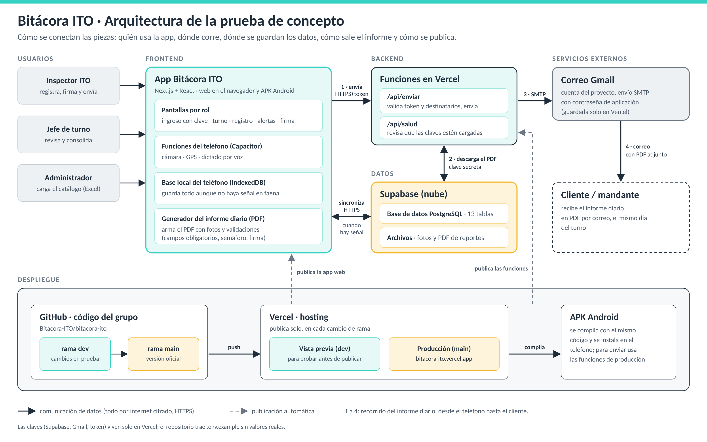

# Arquitectura de la prueba de concepto

Bitácora ITO tiene cinco partes. Las flechas del diagrama muestran cómo se comunican.

| Parte | Qué es | Qué hace |
|---|---|---|
| **Frontend** | App Bitácora ITO (Next.js), en el navegador o como APK Android | El inspector registra avances, alertas y fotos, firma y envía. El jefe de turno consolida. El administrador carga el catálogo en Excel. Guarda todo en el teléfono para funcionar sin señal y arma el PDF del informe. |
| **Backend** | Funciones en Vercel (`/api/enviar` y `/api/salud`) | Recibe el pedido de envío, revisa que sea de la app y que el destinatario esté autorizado, y manda el correo. |
| **Datos** | Supabase: base de datos (13 tablas) y archivos (fotos y PDF) | Guarda en la nube lo que se registró en el teléfono, cuando hay señal. |
| **Servicios externos** | Correo Gmail del proyecto | Entrega el informe diario en PDF al cliente o mandante. |
| **Despliegue** | GitHub + Vercel | Cada cambio en la rama `dev` genera una vista previa. Cada cambio en `main` publica la versión oficial en **https://bitacora-ito.vercel.app**. El APK se compila con el mismo código. |

## Recorrido del informe diario

1. La app envía el informe a `/api/enviar` por internet cifrado (HTTPS), con un código de la app.
2. La función descarga el PDF desde Supabase con la clave secreta.
3. La función lo entrega a Gmail.
4. El cliente recibe el correo con el PDF el mismo día del turno.

## Claves

Las claves de Supabase, Gmail y el código de la app se guardan solo en Vercel. El repositorio trae `.env.example` con valores de ejemplo, nunca con los reales.
