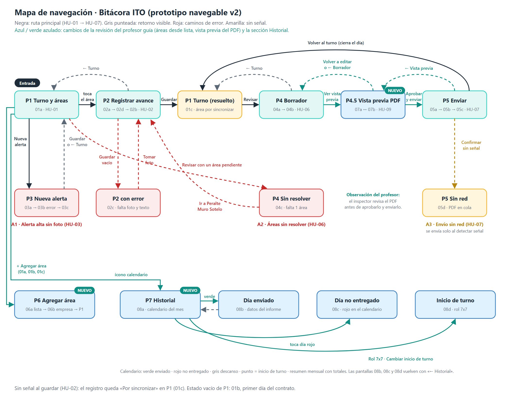

# Prototipo navegable · Bitácora ITO

**Enlace al prototipo en Figma:** [abrir prototipo navegable](https://www.figma.com/proto/6lebHYRTbcb8f5WOnMW3pv/Sin-t%C3%ADtulo?node-id=1-2&p=f&t=XOez3IwfZ95WUirR-1&scaling=min-zoom&content-scaling=fixed&page-id=0%3A1&starting-point-node-id=1%3A2&show-proto-sidebar=1)

Al abrirlo, la barra lateral muestra cinco flujos:

| Flujo | Parte en |
|---|---|
| **Ruta principal** | 01a |
| **A1 · Alerta alta sin foto** | 03a |
| **A3 · Envío sin red** | 05d |
| **Estado vacío** | 01b |
| **Historial** (nuevo) | 08a |

El camino A2 (áreas sin resolver) se recorre desde la ruta principal: hay que tocar «Revisar reporte del turno» antes de registrar el área Peralte Muro Sotelo.

**Versión 2 (semana 6):** se incorporan las dos observaciones del profesor guía y una sección nueva. El detalle está en la [sección 5](#5-cambios-de-la-versión-2).

- Las áreas se eligen de una lista: ni el inspector ni nadie las escribe.
- El PDF se previsualiza antes de aprobarlo y enviarlo.
- Sección nueva: Historial con calendario.

**Origen:**

- Las pantallas P1 a P5 del wireframe anotado de la semana 4.
- Las historias HU-01 a HU-10 de `historias.md`. HU-02 sigue siendo la historia del flujo principal.

**Dispositivo:** teléfono, marco de 390 × 844 px (iPhone 13/14 en Figma).

**Quién lo prueba:** el inspector de terreno, en faena, con guantes y a veces sin señal.

Vista general de los 25 marcos: [pantallas-vista-general.png](pantallas-vista-general.png)

---

## 1. Pantallas y su historia de origen

Las letras (a, b, c, d) son estados de la misma pantalla, no pantallas nuevas.

| Pantalla | Historia de origen | Marcos (estados) | Criterio que verifica |
|---|---|---|---|
| **P1 Turno y áreas** | HU-01 | 01a con datos · 01b vacío · 01c registro guardado sin señal | Al abrir la app, el inspector ve la fecha, el turno y las áreas del turno. Cada área aparece con su empresa y con estado: con registro, sin actividad o pendiente |
| **P2 Registrar avance** | HU-02 (y HU-04) | 02a vacío · 02b cargando · 02c error · 02d con datos | Al tomar la foto, dictar y guardar, el registro queda asociado al área con hora y ubicación, y el área aparece con registro en P1 |
| **P3 Nueva alerta** | HU-03 | 03a sin foto · 03b error · 03c con datos | Si la criticidad es alta, no se guarda la alerta sin al menos una fotografía de respaldo |
| **P4 Borrador del reporte** | HU-06 | 04a cargando · 04b con datos · 04c áreas sin resolver | Si quedan áreas sin registro ni declaradas sin actividad, se listan y se pide resolverlas antes del borrador |
| **P4.5 Vista previa del PDF** (nueva) | HU-09 | 07a página 1 · 07b página 2 | El inspector ve el PDF tal como se enviará, en el formato del mandante, y solo desde ahí puede aprobarlo y enviarlo |
| **P5 Enviar al mandante** | HU-07 | 05a con datos · 05b cargando · 05c enviado · 05d sin red | Al confirmar, se genera el PDF, se envía y queda registrada la fecha, la hora y quién aprobó; sin señal, queda en cola |
| **P6 Agregar área** (nueva) | HU-05 | 06a lista de áreas · 06b empresa | El área se elige del catálogo del contrato (14 áreas) y después la empresa que ejecuta. No hay campo de texto |
| **P7 Historial** (nueva) | HU-10 | 08a calendario · 08b día enviado · 08c no entregado · 08d inicio de turno | El calendario del mes marca cada día como enviado, no entregado o descanso según el rol 7x7, y muestra el resumen del mes |

HU-08 (consulta de la jefatura) queda fuera del prototipo. El Historial es la consulta del propio inspector.

---

## 2. Mapa de navegación

**Punto de entrada:** P1 Turno y áreas (01a).

**Ruta principal (escenario de éxito, HU-01 → HU-07):**
P1 Turno → toca «Peralte Muro Sotelo» → P2 Registrar avance → Guardar → P1 con el área resuelta → Revisar reporte → P4 Borrador → **Ver vista previa del PDF → P4.5 Vista previa (página 1 ↔ página 2) → Aprobar y enviar** → P5 Enviar → Confirmar → Enviado → Volver al turno

**Retornos visibles (arriba a la izquierda en cada pantalla):**

| Pantalla | Retorno | Vuelve a |
|---|---|---|
| P1 Turno y áreas | Es la raíz: todo vuelve a ella | — |
| P2 Registrar avance | ← Turno | P1 |
| P3 Nueva alerta | ← Turno | P1 |
| P4 Borrador | ← Turno, y «Editar registros» | P1 / P2 |
| P4.5 Vista previa | ← Borrador y «Volver a editar» | P4 |
| P5 Enviar | ← Vista previa (antes de enviar), ← Turno y «Volver al turno» (después) | P4.5 / P1 |
| P6 Agregar área | 06a: ← Turno · 06b: ← Áreas y «Cambiar» | P1 / 06a |
| P7 Historial | 08a: ← Turno y «Volver al turno» · 08b, 08c y 08d: ← Historial | P1 / 08a |

**Caminos alternativos (tomados de los criterios de aceptación):**

| Código | Historia | Situación | Recorrido en el prototipo |
|---|---|---|---|
| **A1** | HU-03 | Alerta de criticidad alta sin fotografía | P1 → Nueva alerta → 03a → Guardar → 03b error junto al campo → Tomar fotografía → 03c → Guardar → P1 |
| **A2** | HU-06 | Áreas sin resolver al pedir el reporte | P1 (01a, con Peralte Muro Sotelo pendiente) → Revisar reporte → 04c lista el área → Ir a Peralte Muro Sotelo → P2 |
| A3 (adicional) | HU-07 | Envío sin cobertura de red | P5 → 05d «Pendiente de envío por falta de red · PDF guardado» → Volver al turno |
| A4 (adicional) | HU-02 | Guardar sin señal en el área | P2 → Guardar → 01c, el área aparece «Por sincronizar» con aviso de que se enviará sola |
| A5 (nuevo) | HU-05 | Aparece un área que no está en el turno | P1 → Agregar área → 06a elige «Túnel PAMo» (las que ya están en el turno salen marcadas) → 06b elige la empresa → Agregar al turno → P1 |
| A6 (nuevo) | HU-09 | El inspector detecta un error en la vista previa | P4.5 → Volver a editar → P4 → Editar registros → P2 |
| A7 (nuevo) | HU-10 | Revisar un día anterior | P1 → ícono calendario → 08a → día verde (08b, datos del informe) o día rojo (08c, no entregado) → ← Historial |

**Estado vacío de P1 (HU-01, primer día del contrato):** 01b, lista de áreas vacía con «Agregar primera área», que abre 06a.

---

## 3. Formulario y estados (P2 Registrar avance)

### Campos y por qué están

Solo campos que pide HU-02 y que existen en la estructura de datos del Avance 3 (los mismos que anota el wireframe).

| Campo | Atributo de datos | Obligatorio | Control | Por qué está | Mensaje de error junto al campo |
|---|---|---|---|---|---|
| Fotografía | `fotografia` | Sí | Botón grande «Tomar fotografía» | Es la evidencia del avance | «Toma al menos 1 fotografía del avance.» |
| Ubicación | `latitud`, `longitud` | Sí (automática) | Precargada por GPS | HU-02 pide la ubicación en que se tomó, sin escribirla | (no aplica: se captura sola) |
| Empresa | `empresa_id` | Sí | Precargada con el área (P6); se puede cambiar desde la lista del contrato | El reporte agrupa por empresa | «Elige la empresa.» |
| Origen de la descripción | `origen_descripcion` | Sí | Selector Dictar / Escribir | Dictar es lo que ahorra tiempo; escribir es la salida si hay ruido | (tiene valor por defecto: Dictar) |
| Descripción del avance | `descripcion` | Sí | Texto dictado o escrito, con «Repetir dictado» | Es el contenido del reporte | «Dicta o escribe qué se avanzó.» |
| Declarar sin actividad | `sin_actividad` | No | Interruptor | HU-04: declarar el área sin trabajos con un toque | (si el área ya tiene registros, pide confirmación) |

`frente_id` (el área) y `registrado_en` no se piden: vienen del área elegida en P1 y del reloj del teléfono.

### Las cuatro decisiones del apunte, aplicadas

1. **Solo campos justificados:** cada campo tiene historia y atributo de datos.
2. **Etiqueta visible:** sobre el campo; el asterisco rojo y «* obligatorio» se ven antes de llenar, no después del error.
3. **Error junto al campo:** borde rojo, ícono y un mensaje que dice cómo corregir, más un aviso arriba con cuántos datos faltan.
4. **Precargar o elegir antes que escribir:** ubicación precargada, área y empresa elegidas de una lista, descripción dictada.

### Los cuatro estados

| Estado | Marco | Qué ve el inspector |
|---|---|---|
| Vacío | 02a | Sin foto ni descripción; ubicación ya precargada; requisitos visibles |
| Cargando | 02b | Formulario atenuado y botón «Guardando registro…» |
| Con error | 02c | «Faltan 2 datos para guardar», borde rojo y mensaje bajo la foto y bajo la descripción; lo demás se conserva |
| Con datos | 02d | Foto, empresa, descripción dictada y la opción «Repetir dictado» (escenario de dictado defectuoso de HU-02) |

Los estados también están en las otras pantallas donde importan: P1 vacío (01b), P3 error (03b), P4 cargando y error (04a, 04c), P5 cargando y sin red (05b, 05d), Historial no entregado (08c).

---

## 4. Registro de decisiones

### Qué quedó simulado y qué funciona de verdad

| Elemento | Simulado o funcional | Cómo se representa |
|---|---|---|
| Navegación, retornos y caminos alternativos | **Funcional** | Enlaces de Figma en cada botón y retorno |
| Validación de P2 y de P3 | **Funcional en el recorrido** | «Guardar» con datos faltantes lleva al marco de error |
| Estados vacío / cargando / error / con datos | **Funcional** | Marcos separados; los de carga avanzan solos («After delay») |
| Cámara | Simulado | «Tomar fotografía» salta al marco con una foto de ejemplo |
| Dictado y transcripción | Simulado | Tocar «Dictar» o «Tomar fotografía» lleva a 02d, con el texto de ejemplo ya transcrito |
| GPS | Simulado | Coordenadas fijas -22.4512, -68.9231 |
| Guardado sin señal y sincronización | Simulado | Etiqueta «Por sincronizar» y aviso en 01c |
| Generación del borrador | Simulado | 04a muestra el avance y pasa a un borrador de ejemplo |
| Agregar área (HU-05) | **Funcional en el recorrido** | 01a/01b/01c → 06a (lista del contrato) → 06b (empresa) → P1. P1 no muestra la fila nueva: el regreso es a la pantalla de ejemplo |
| Vista previa del PDF (HU-09) | **Funcional en el recorrido** | 04b → 07a; el paginador «‹ 1 / 2 ›» cambia de página; «Aprobar y enviar» lleva a 05a. La página replica el formato del mandante con datos de ejemplo |
| Historial (HU-10) | **Funcional en el recorrido** | 01a → 08a; los días verdes (8, 9, 10, 12 y 13) abren 08b; el día rojo (11) abre 08c; «Cambiar» abre 08d |
| Envío y acuse | Funcional en flujo | 05c confirma «Enviado 17:58 · acuse recibido» |
| Clima del turno | Simulado | Selector visible, no cambia nada |
| Declarar sin actividad (HU-04) | Fuera del recorrido | Visible para que el usuario sepa que existe; no navega |
| Inicio de sesión | Fuera del prototipo | Se asume sesión iniciada |

- **Exclusión deliberada de cronogramas (Primavera P6 / MS Project):** el sistema no se enlaza con partidas ni con porcentajes de avance de programas de obra, para no recargar al inspector en terreno. El reporte registra lo observado durante el turno y las desviaciones o alertas, y prioriza la velocidad de captura con dictado por voz.

### Qué se observa en la prueba con usuarios (semana 7)

| Pantalla | Se cumple si el inspector… |
|---|---|
| P1 | Dice en voz alta qué área le falta en menos de 5 segundos |
| P2 | Registra el avance de Peralte Muro Sotelo sin ayuda y en menos de 1 minuto |
| P2 con error | Corrige al primer intento sin volver a llenar lo que tenía |
| P3 | Entiende por qué no se guardó la alerta alta y adjunta la foto |
| P4 | Aprueba el borrador sin reescribirlo, o lo resuelve si falta un área |
| P4.5 | Reconoce el formato del mandante y encuentra en la vista previa un dato que quiera corregir |
| P5 | Sabe que el reporte se envió (o quedó en cola) y no lo reenvía para asegurarse |
| P6 | Agrega un área nueva sin escribir nada, en menos de 15 segundos |
| P7 | Dice cuántos informes envió en el mes y qué día no entregó, en menos de 10 segundos |

### Decisiones de diseño

- **Una acción primaria por pantalla:** un solo botón turquesa abajo, al alcance del pulgar (Ley de Fitts). Lo secundario va con borde y sin relleno.
- **Sistema mínimo:**
  - 2 tamaños de texto (16 y 24);
  - 1 color de acción: turquesa 35D2C3, con texto 1E2B38;
  - 1 color de alerta: rojo C62828;
  - 1 unidad de espaciado: 8 px, con márgenes de 16 px.

  El Historial suma el verde 2E9E5B para «enviado».
- **Estado con palabra y color:** «Con registro», «Pendiente», «Sin actividad», «Por sincronizar», «En el turno», «Enviado» y «No entregado» siempre van escritos, no solo pintados. El calendario tiene leyenda.
- **Accesibilidad (WCAG 2.2, criterio 2.5.8):** objetivos táctiles de 44 px o más, sobre el mínimo de 24 × 24, pensando en uso con guantes. Las filas de la lista de áreas miden 43 px y cada día del calendario, 44 px.
- **Patrones conocidos (Ley de Jakob):** retorno arriba a la izquierda, lista con flecha, botón principal abajo y calendario mensual de lunes a domingo.
- **Números grandes y no gráficos** en el resumen de P4 («5 áreas», «2 alertas») y en el resumen del mes del Historial («5 enviados», «1 no entregado», «7 descanso»).
- **Datos de ejemplo:**
  - del wireframe: contrato 4600026893, J. Orellana, TECNASIC, inspeccion@mandante.cl;
  - las 14 áreas, de la lista del contrato (`Áreas.xlsx`);
  - el formato de la vista previa, del reporte diario real REV1 del 27-09-2026.

---

## 5. Cambios de la versión 2

### Observación 1 del profesor: «las áreas no las debe escribir el inspector; deben venir en un despliegue»

- El catálogo de **áreas** (14, de la lista del contrato) y de **empresas** (TECNASIC, GEOINYECTA, IDIEM, OOCC) viene precargado con el contrato. Lo carga la jefatura, no el inspector.
- «+ Nuevo frente» pasa a **«+ Agregar área»** y abre **06a**, una lista sin campo de texto. Las áreas que ya están en el turno salen marcadas y no se pueden repetir. Después se elige la empresa en **06b**.
- En todas las pantallas, «frente» pasa a **«área»** y cada fila muestra el área y su empresa («Peralte Muro Sotelo · TECNASIC»).
- En el reporte, el área se numera sola como sección (1.0, 2.0…) y la empresa queda como subsección (1.1, 2.1…), igual que en el formato del mandante.

### Observación 2 del profesor: «antes de generar el PDF, el inspector debe poder revisarlo»

- En 04b, «Aprobar reporte» pasa a **«Ver vista previa del PDF»**.
- La pantalla nueva **P4.5 (07a y 07b)** muestra el PDF página por página en el formato del mandante: encabezado JEJ, correlativo, clima, tabla de alertas en 4 columnas, cuerpo por áreas con sus empresas y fotos a la derecha.
- Desde la vista previa hay dos salidas: **«Volver a editar»** (vuelve a P4) o **«Aprobar y enviar»** (va a P5). La aprobación queda después de haber visto el documento.
- El marco que el equipo había hecho como 05e (previsualización después de enviar) se transformó en 07a. La tarjeta del PDF en 05a sigue abriendo la vista previa.

### Sección nueva: Historial (HU-10)

- Ícono de calendario arriba a la derecha en P1, que abre **08a**: el calendario del mes con cada día en verde (enviado), rojo (no entregado) o gris (descanso), más el resumen del mes y el del mes anterior.
- La diferencia entre descanso y no entregado la da el **rol 7x7**. El inspector marca el **primer día de su turno** en **08d** y desde ahí se calculan los ciclos. Cada inicio de turno queda marcado con un punto en el calendario.
- Al tocar un día enviado, **08b** muestra los datos con que se armó ese informe (los mismos de la vista previa), no el PDF. Al tocar un día rojo, **08c** muestra por qué cuenta como no entregado.
