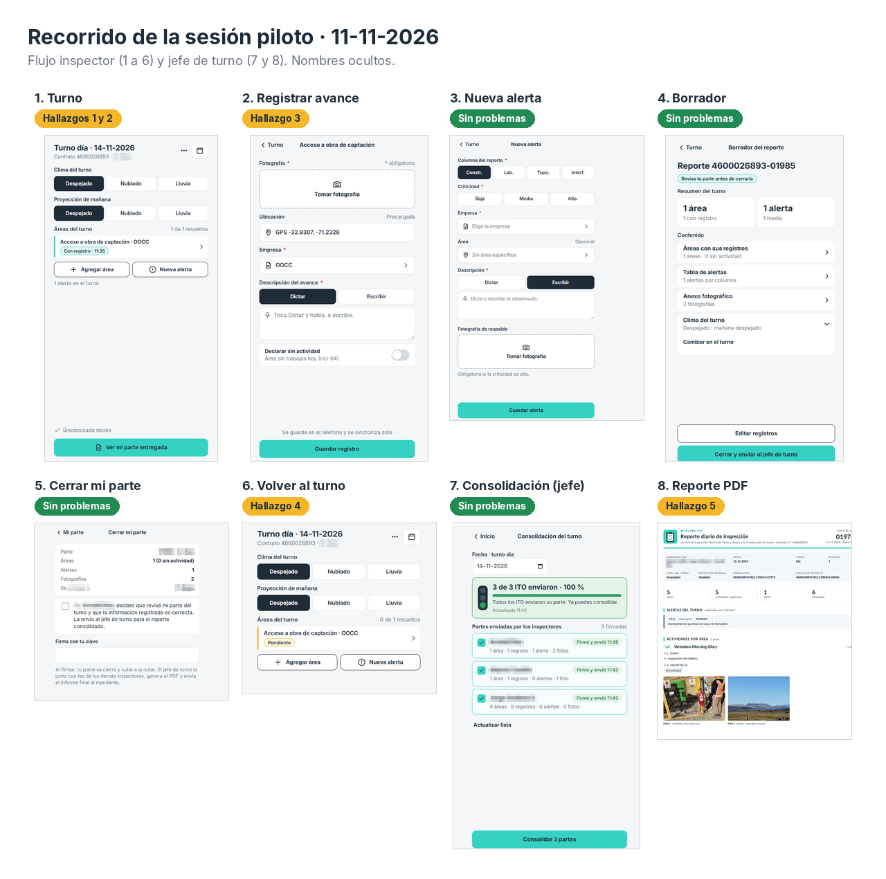
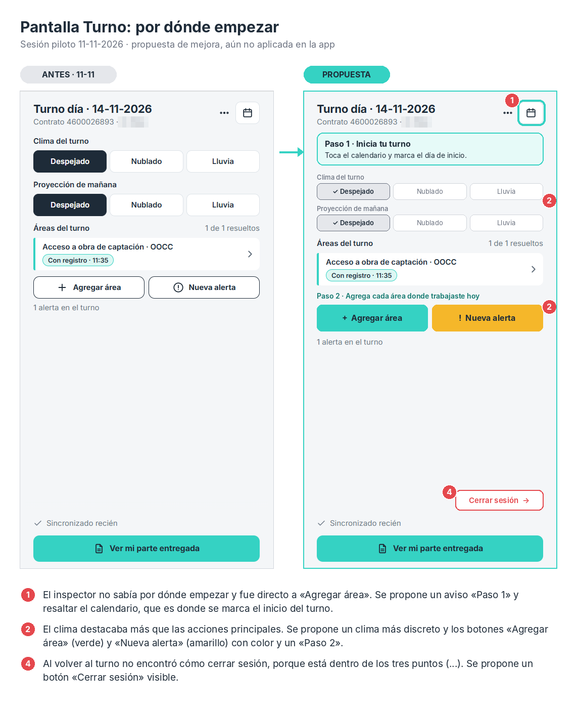
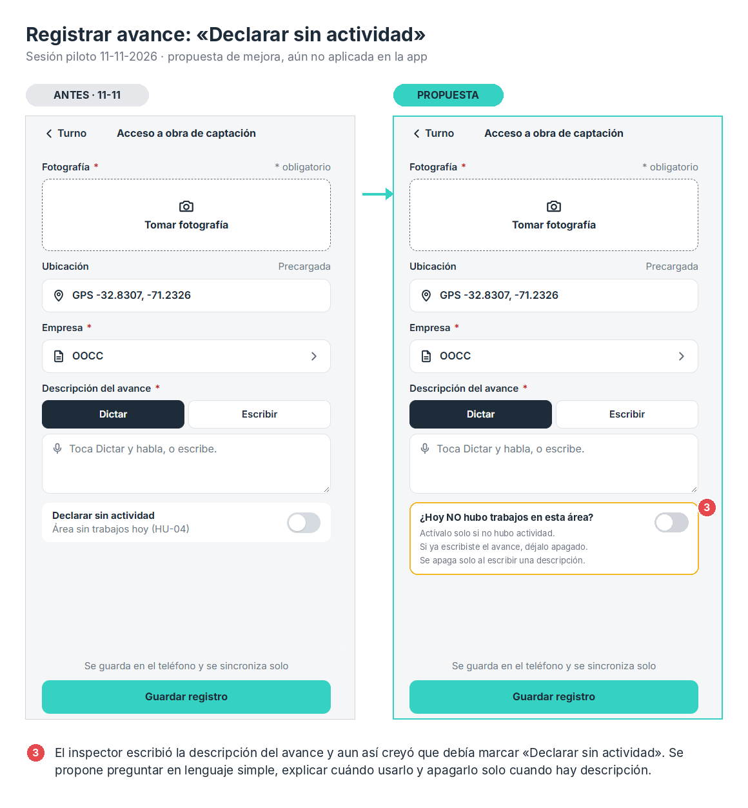
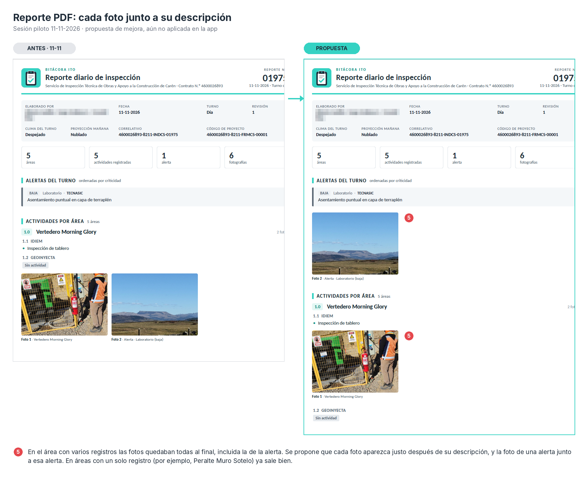
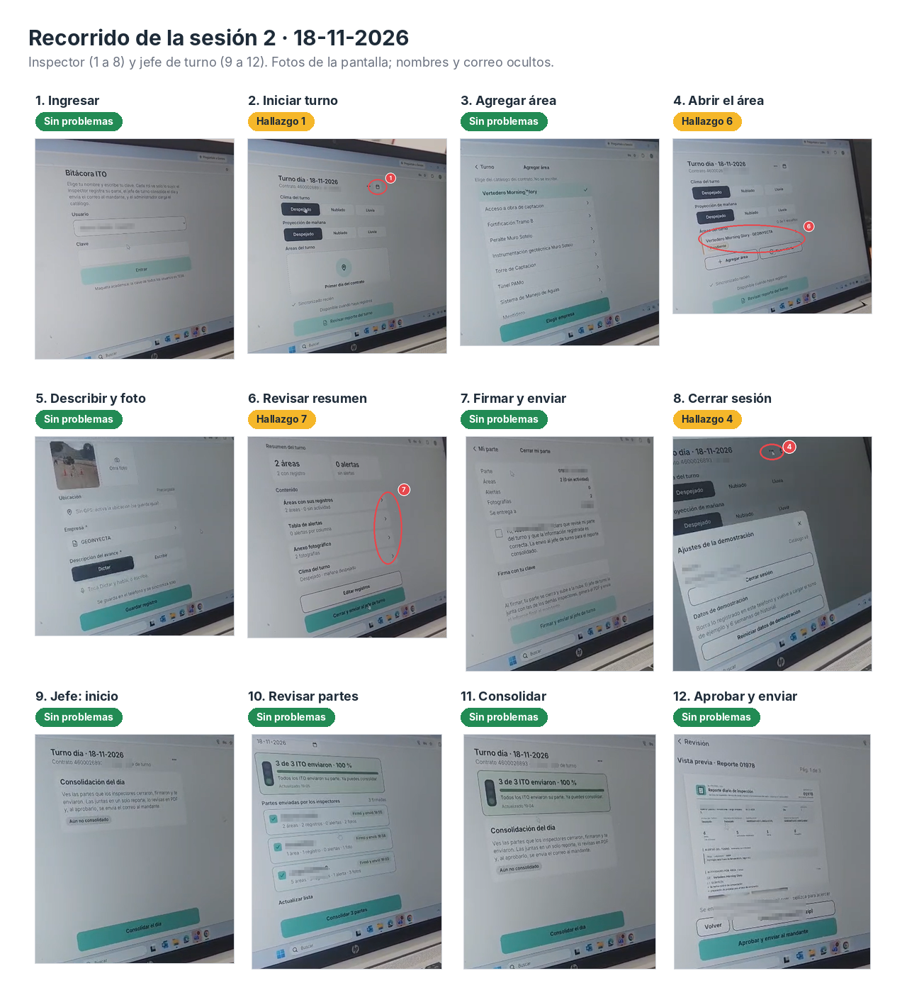
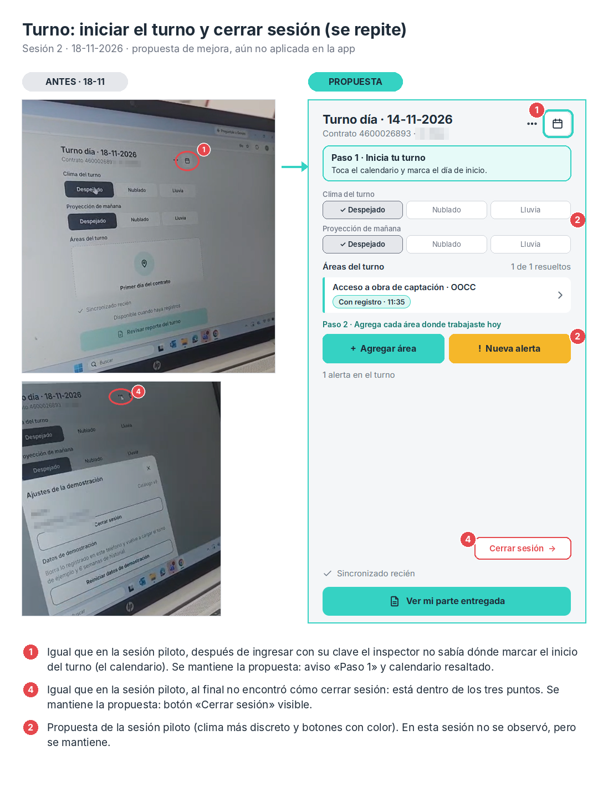
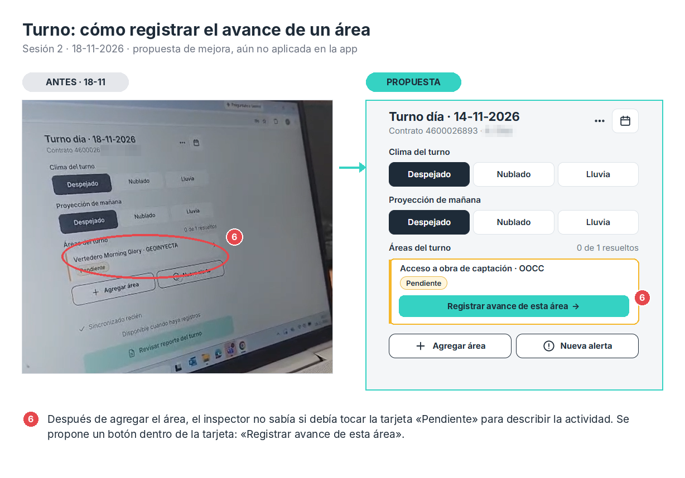
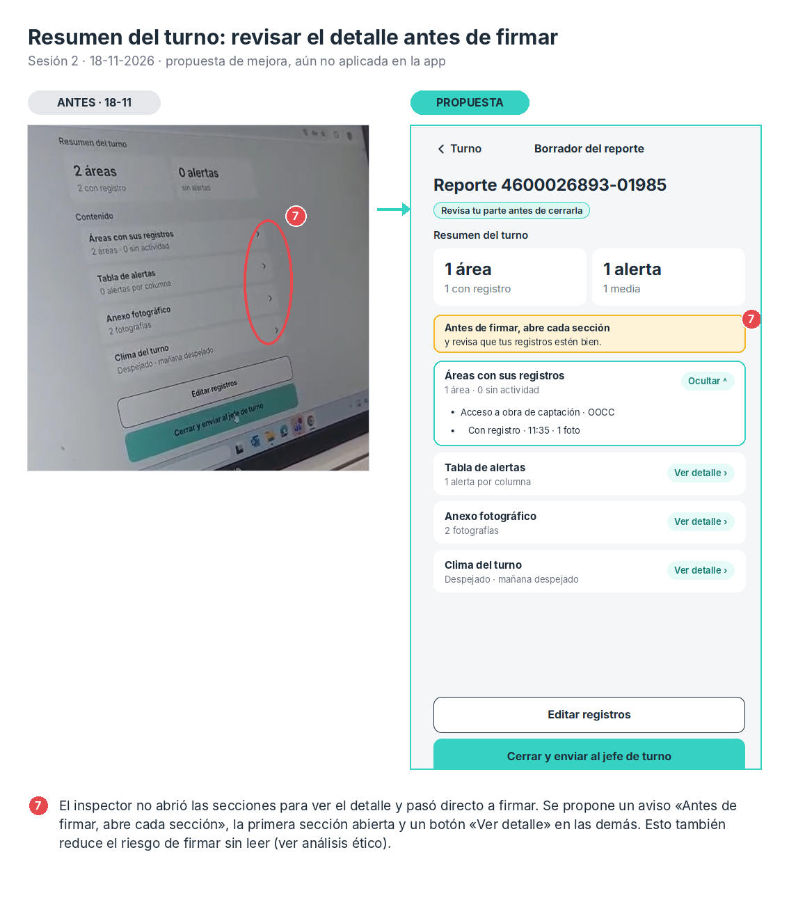

# Prueba de usuarios

**Proyecto:** Bitácora - ITO · **Fecha:** 14 de noviembre de 2026 · **Base:** Apunte 5.1
**Periodo de la prueba:** dos semanas, del 11 al 20 de noviembre de 2026. **Estado: cerrada** (resultados en la [sección 6](#6-cierre-de-la-prueba)).
**Pauta que se lee en cada sesión:** [pauta-validacion.md](pauta-validacion.md)

Esta prueba no es una demostración. Es un experimento para saber si las personas correctas completan el flujo principal **sin ayuda**, y puede demostrar que el equipo estaba equivocado.

---

## 1. Diseño de la prueba

### Objetivo

Comprobar que un inspector de terreno registra su turno, revisa su parte y la firma sin ayuda, y que un jefe de turno consolida las partes y envía el reporte al mandante, también sin ayuda.

### Qué se valida y qué no

| Se valida (uso) | No se valida en esta prueba |
|---|---|
| Que el flujo se entienda y se complete sin ayuda | Integración, seguridad y permisos (semana 11) |
| Cuánto esfuerzo cuesta: tiempo, desvíos, errores y pedidos de ayuda | Si a la empresa le conviene pagar por la app (valor) |
| Cómo lo percibe la persona al terminar (SUS) | El panel del administrador (catálogo en Excel) |

### Hipótesis

| N.º | Hipótesis |
|---|---|
| H1 | El inspector inicia el turno, registra un avance y una alerta, y firma su parte sin pedir ayuda. |
| H2 | El inspector distingue un área con avance de un área sin actividad. |
| H3 | El jefe de turno entiende el semáforo, consolida y envía el reporte sin pedir ayuda. |
| H4 | El inspector y el jefe de turno entienden el reporte PDF y encuentran la foto de cada registro. |

### Tareas

Se proponen como escenarios, sin nombrar botones. El texto exacto está en la [pauta](pauta-validacion.md).

| Tarea | Perfil | Qué debe lograr | Hipótesis |
|---|---|---|---|
| T1 | Inspector | Iniciar el turno del día | H1 |
| T2 | Inspector | Registrar el avance de un área con foto y descripción | H1 |
| T3 | Inspector | Dejar constancia de un área donde no hubo trabajos | H2 |
| T4 | Inspector | Levantar una alerta con su criticidad | H1 |
| T5 | Inspector | Revisar su parte, firmarla y salir de la app | H1 |
| T6 | Jefe de turno | Saber cuántos inspectores enviaron, consolidar y enviar el reporte | H3 |
| T7 | Ambos | Encontrar en el PDF la foto de un registro | H4 |

### Métricas

| Dimensión | Qué se mide | Cómo |
|---|---|---|
| Efectividad | Tasa de éxito sin ayuda por tarea | Logrado sin ayuda / con ayuda / no logrado |
| Eficiencia | Tiempo por tarea, desvíos, errores y pedidos de ayuda | Planilla del registrador y grabación |
| Satisfacción | Puntaje SUS (0 a 100) al terminar | Cuestionario de 10 preguntas |

### Criterio de decisión (fijado antes de observar)

| Si ocurre esto | Se decide |
|---|---|
| Menos del 80 % de los participantes de un perfil logra una tarea sin ayuda | La pantalla de esa tarea **cambia** antes de seguir |
| Un problema **bloquea** a 1 persona | Se corrige antes de pasar a arquitectura |
| Un problema **entorpece** a 2 o más personas del mismo perfil | Se compromete el cambio y se prueba de nuevo |
| El SUS promedio de un perfil es menor que 68 | Se revisan las tareas con más fricción, aunque se hayan logrado |
| El flujo completo del inspector supera los 15 minutos (mediana) | Se revisa el orden de los pasos |
| Un problema es **estético** | Se anota y espera mientras haya problemas más severos |

Severidad según el apunte: **bloquea** (no completa), **entorpece** (completa con fricción) y **estética** (completa y solo molesta). Toda observación termina en una de tres salidas: cambio comprometido, riesgo aceptado con justificación o pregunta para otra ronda.

---

## 2. Perfiles y reclutamiento

| Perfil | Cantidad | Por qué | Cómo se contacta |
|---|---|---|---|
| Inspector técnico de terreno (ITO) | 5 | Usuario primario. Ejecuta las tareas T1 a T5 y T7. | Contactos laborales de la integrante que trabaja en minería y, con autorización, inspectores de la empresa ITO |
| Jefe de turno o supervisor de inspección | 5 | Usuario primario. Ejecuta T6 y T7. | Mismo canal, con invitación por correo o WhatsApp |
| Mandante y administrador (stakeholders) | 1 a 2 | No validan el uso. Se les consulta por restricciones de adopción, en una conversación aparte. | Contacto directo |

Cinco personas por perfil descubren cerca del 85 % de los problemas de uso (Nielsen, 2000). Se busca **variedad**: distintas edades, experiencia con el teléfono y años en terreno.

**Exclusiones**

- Integrantes del equipo y compañeros del curso: conocen la app y no representan al usuario.
- Personas que ya vieron una demostración guiada de la app.
- Personas a cargo directo de la evaluación de desempeño de otro participante.

**Resguardos éticos** (Ley 21.719 y [análisis ético](etica.md))

- La participación es voluntaria y la persona puede retirarse cuando quiera, sin dar explicación.
- Se pide consentimiento **antes** de grabar: qué se graba, para qué, quién lo verá y cuánto tiempo se guarda.
- Se graba la pantalla y la voz, **no el rostro**.
- Cada participante se identifica con un código (P1, P2…). En el repositorio no se publican nombres; en los pantallazos se ocultan.
- Se evalúa la app, **no a la persona**. Los resultados no se entregan a la empresa con nombres ni se usan para evaluar desempeño.
- Se usan datos de ejemplo del contrato. No se registran fotos ni datos reales de faena.

---

## 3. Plan de levantamiento

### Sesiones

| Semana | Fechas | Qué se hace |
|---|---|---|
| 0 | 11-11-2026 | Sesión piloto con 1 participante (hecha, ver sección 4) |
| 1 | 18-11-2026 | Sesión 2 con 1 inspector (P1) y 1 jefe de turno (J1) (hecha, ver sección 5) |
| 2 | 20-11-2026 | Análisis y cierre de la prueba (ver sección 6) |

Cada sesión dura unos 30 minutos, en terreno o por videollamada, con el teléfono del participante o uno del equipo con la app instalada.

### Roles en cada sesión

| Rol | Qué hace | Qué evita |
|---|---|---|
| Facilitador | Lee el escenario y las tareas; pregunta solo para aclarar hechos | Ayudar, explicar o defender el diseño |
| Registrador | Anota acciones, dudas, desvíos, citas, tiempo y ayuda; una fila por observación | Mezclar lo observado con su interpretación |
| Responsable de evidencia | Graba pantalla y voz, guarda en el Drive restringido y enlaza desde el README | Guardar grabaciones en el repositorio o en teléfonos personales |

Los roles rotan entre los integrantes del equipo.

### Grabaciones y evidencia

- Se guardan en una carpeta de **Google Drive restringida** al equipo y al profesor, fuera del repositorio.
- Nombre de archivo: `AAAA-MM-DD_P1_inspector.mp4`, sin nombres de personas.
- Se conservan hasta el cierre del semestre y luego se eliminan.
- Enlace controlado: [Evidencia de la prueba de usuarios (Drive restringido)](https://drive.google.com/drive/folders/1tUrYn61Pu5rgfOUttUz2DBbsO1Ho4Enc?usp=sharing)

### Planilla de observaciones

Una fila por observación. Primero lo ocurrido, después la interpretación.

| Fecha | Participante | Perfil | Tarea | Resultado (sin ayuda / con ayuda / no logra) | Tiempo | Observado (hecho) | Interpretado (hipótesis) | Severidad | Decisión |
|---|---|---|---|---|---|---|---|---|---|

La planilla se guarda en el mismo Drive. Al cierre se cuentan las fricciones repetidas, no la intensidad de la opinión del equipo.

### Regla para decidir cambios

1. Se agrupan las observaciones iguales y se cuenta cuántas personas las tuvieron.
2. Se asigna la severidad (bloquea, entorpece o estética).
3. Se aplica el criterio de decisión de la sección 1.
4. Cada hallazgo queda con responsable y una salida: cambio comprometido, riesgo aceptado o pregunta para otra ronda.
5. **Los cambios a la app se hacen después de la prueba**, con la evidencia de todas las sesiones, no después de una sola.

---

## 4. Evidencia: sesión piloto del 11-11-2026

Primera prueba con **un participante (P0)**, que recorrió el flujo del inspector y luego el del jefe de turno. Sirvió para ensayar la pauta. Los pantallazos originales están en el Drive restringido; aquí se muestran con los nombres ocultos.

### Hallazgos

| N.º | Pantalla | Observado | Severidad | Propuesta |
|---|---|---|---|---|
| 1 | Turno | No sabía por dónde empezar. Fue directo a «Agregar área», cuando primero debía marcar el día de inicio en el calendario. | Entorpece | Aviso «Paso 1 · Inicia tu turno» y calendario resaltado |
| 2 | Turno | El clima del turno y la proyección destacaban más que «Agregar área» y «Nueva alerta». | Entorpece | Clima más discreto; botones con color y «Paso 2 · Agrega cada área» |
| 3 | Registrar avance | Escribió la descripción y aun así creyó que debía marcar «Declarar sin actividad». | Entorpece | Preguntar «¿Hoy NO hubo trabajos en esta área?», explicar cuándo usarlo y apagarlo al escribir |
| 4 | Volver al turno | No supo cómo cerrar sesión: la opción está dentro de los tres puntos. | Entorpece | Botón «Cerrar sesión» visible |
| 5 | Reporte PDF | En un área con varios registros, las fotos quedaron todas al final, incluida la de la alerta. En áreas con un registro (Peralte Muro Sotelo) sale bien. | Estética | Cada foto justo después de su descripción; la foto de una alerta, junto a la alerta |

**Sin problemas:** registrar avance con foto y empresa, nueva alerta, revisión del borrador, cerrar mi parte y consolidación del jefe de turno. La persona avanzó de forma intuitiva.

**Decisión:** las cinco propuestas quedan como **pregunta para la ronda 1**. No se cambia la app todavía: con una sola persona no hay fricción repetida. Si en la ronda 1 se repiten en 2 o más personas, se comprometen los cambios. Si alguien no logra iniciar el turno sin ayuda, el hallazgo 1 pasa a **bloquea**.

### Propuestas de mejora sobre los pantallazos

## 5. Evidencia: sesión 2 del 18-11-2026

Segunda prueba con **un inspector (P1)** y **un jefe de turno (J1)**, con la pauta de validación. Se grabó en video; los videos y las fotos originales están en el [Drive restringido](https://drive.google.com/drive/folders/1tUrYn61Pu5rgfOUttUz2DBbsO1Ho4Enc?usp=sharing). Aquí se muestran con nombres y correo ocultos.

Los hallazgos siguen la numeración de la sesión piloto: si un problema se repite, conserva su número.

### Hallazgos

| N.º | Pantalla | Observado | Severidad | ¿Se repite? | Propuesta |
|---|---|---|---|---|---|
| 1 | Turno | Después de ingresar con su clave, no sabía dónde marcar el inicio del turno (calendario). | Entorpece | **Sí** (2 de 2) | Aviso «Paso 1» y calendario resaltado |
| 6 | Turno | Después de agregar el área, no sabía si debía tocar la tarjeta «Pendiente» para describir la actividad. | Entorpece | Nuevo | Botón «Registrar avance de esta área» dentro de la tarjeta |
| 7 | Resumen del turno | No abrió las secciones para ver el detalle y pasó directo a firmar. | Entorpece | Nuevo | Aviso «Antes de firmar, abre cada sección» y botón «Ver detalle» |
| 4 | Turno | Al final no sabía cómo cerrar sesión: está dentro de los tres puntos. | Entorpece | **Sí** (2 de 2) | Botón «Cerrar sesión» visible |

**Sin problemas:** ingresar con usuario y clave, agregar un área del catálogo, describir la actividad con foto, y firmar y enviar la parte al jefe de turno. El **jefe de turno** consolidó las partes, revisó el PDF y lo envió al mandante sin problemas.

### Propuestas de mejora sobre los pantallazos

---

## 6. Cierre de la prueba

La prueba se cierra con **dos sesiones** (11 y 18 de noviembre) y **3 personas**: P0 en la piloto (hizo el flujo del inspector y el del jefe de turno), P1 como inspector y J1 como jefe de turno en la sesión 2. Los cambios **no se aplican todavía** a la app: quedan para la próxima versión.

### Resultado por tarea

Para cada tarea se anotó si la persona **tuvo dudas** (se desvió, no supo dónde tocar o preguntó). Todas las personas terminaron el flujo completo.

La meta, fijada antes de la prueba, es que **al menos el 80 % de las personas haga la tarea sin dudas**. Con 2 personas, eso significa que las 2 la hagan sin dudas.

| Tarea | ¿Tuvo dudas? Sesión piloto | ¿Tuvo dudas? Sesión 2 | Personas sin dudas | ¿Cumple la meta? |
|---|---|---|---|---|
| T1 Iniciar el turno (calendario) | Sí | Sí | 0 de 2 | ❌ No |
| T2a Entrar al área para registrar | No | Sí (no sabía si tocar «Pendiente») | 1 de 2 | ❌ No |
| T2b Describir la actividad y poner foto | No | No | 2 de 2 | ✅ Sí |
| T3 Marcar un área sin actividad | Sí | No se probó | 0 de 1 | ❌ No |
| T4 Levantar una alerta | No | No se probó | 1 de 1 | ✅ Sí |
| T5 Revisar, firmar y cerrar sesión | Sí (cerrar sesión) | Sí (no abrió el detalle y cerrar sesión) | 0 de 2 | ❌ No |
| T6 Consolidar y enviar (jefe de turno) | No | No | 2 de 2 | ✅ Sí |
| T7 Revisar el reporte PDF | No (sugirió poner cada foto junto a su descripción) | No se probó | 1 de 1 | ✅ Sí |

**En total:** de 13 tareas observadas, 7 se hicieron sin dudas (54 %) y las 13 se terminaron (100 %).

**Satisfacción:** al terminar, todas las personas dieron su opinión: la app les pareció **fácil de usar**, dijeron que **facilita y alivia el trabajo** y que solo necesita mejoras pequeñas. Es una opinión declarada, sin puntaje: en esta ronda no se aplicó el cuestionario SUS (0 a 100).

**Eficiencia:** los tiempos quedan en los videos del Drive.

### Resultado de las hipótesis

| Hipótesis | Resultado | Por qué |
|---|---|---|
| H1 · El inspector inicia, registra y firma sin ayuda | **No se cumple** | Termina el flujo, pero en las 2 sesiones dudó al iniciar el turno y al cerrar sesión |
| H2 · Distingue un área con avance de una sin actividad | **No se cumple** (solo se probó en la piloto) | Creyó que debía marcar «sin actividad» aunque ya había escrito el avance |
| H3 · El jefe de turno consolida y envía sin ayuda | **Se cumple** | Los 2 jefes de turno consolidaron y enviaron sin problemas |
| H4 · Se entiende el PDF y se encuentra la foto de cada registro | **Se cumple** | Lo revisó sin dudas; sugirió poner cada foto junto a su descripción (hallazgo 5) |

### Decisiones

Todos los hallazgos quedan como **cambio comprometido** para la próxima versión de la app. Los que pasaron en las 2 sesiones van primero.

| Hallazgo | ¿En cuántas sesiones pasó? | Decisión |
|---|---|---|
| 1 · Iniciar el turno (calendario) | En las 2 | **Cambio comprometido** |
| 4 · Cerrar sesión visible | En las 2 | **Cambio comprometido** |
| 7 · Revisar el detalle antes de firmar | En 1 | **Cambio comprometido**; además, firmar sin leer es un riesgo (ver [análisis ético](etica.md)) |
| 2 · Clima y botones | En 1 | **Cambio comprometido** |
| 3 · «Declarar sin actividad» | En 1 | **Cambio comprometido** |
| 5 · Fotos en el PDF | En 1 | **Cambio comprometido** |
| 6 · Tarjeta «Pendiente» | En 1 | **Cambio comprometido** |

### Cambios aplicados (22-11-2026)

Los 7 cambios comprometidos se aplicaron en la app (versión 3, PR #16) siguiendo los pantallazos de propuesta de las secciones 4 y 5, y están publicados en Vercel.

| Hallazgo | Cómo quedó en la app |
|---|---|
| 1 · Iniciar el turno | Aviso «Paso 1 · Inicia tu turno» y calendario resaltado hasta que el inspector marca el inicio de su ciclo 7x7. El aviso lleva directo a elegir el día y vuelve al turno. Una vez marcado, queda la línea «✓ Turno iniciado el … · Cambiar». |
| 4 · Cerrar sesión visible | Botón «Cerrar sesión» al final de la pantalla Turno y «Terminé: cerrar sesión» en la pantalla de parte firmada. |
| 7 · Revisar el detalle antes de firmar | Aviso «Antes de firmar, abre cada sección», la primera sección abierta y «Ver detalle» en las demás. El aviso pasa a verde cuando se revisaron todas. No bloquea la firma. |
| 2 · Clima y botones | Clima más pequeño y en gris. «Paso 2 · Agrega cada área donde trabajaste hoy», con «Agregar área» en turquesa y «Nueva alerta» en amarillo. |
| 3 · «Declarar sin actividad» | La pregunta «¿Hoy NO hubo trabajos en esta área?», con borde ámbar y una explicación de cuándo usarla. Se apaga sola al escribir la descripción. Si ya hay texto escrito, pide confirmar. |
| 5 · Fotos en el PDF | Cada foto va justo después de la descripción de su registro y la foto de una alerta, junto a la alerta. Las fotos se numeran en el orden en que aparecen. El formato del mandante no cambia. |
| 6 · Tarjeta «Pendiente» | Botón «Registrar avance de esta área» dentro de la tarjeta. |

**Validación técnica:** el set de pruebas automáticas recorrió el flujo completo (administrador, cuatro inspectores, jefe de turno, consolidación y PDF) con datos inventados. Una nueva ronda con inspectores reales podría confirmar si los cambios resuelven las dudas observadas.

**Límites de esta prueba:** se planificaron 5 personas por perfil y participaron 3 personas en total. La satisfacción se recogió con las opiniones de los participantes, que fueron positivas, sin una encuesta con puntaje. Con más participantes se podría confirmar cuáles de los hallazgos vistos una sola vez se repiten.

---

**Referencias:** ISO 9241-11:2018; Brooke (1996); Sauro (2011); Nielsen (1994, 2000); Fitzpatrick (2013); Torresburriel Estudio (2017, 2022); Ley 21.719.
